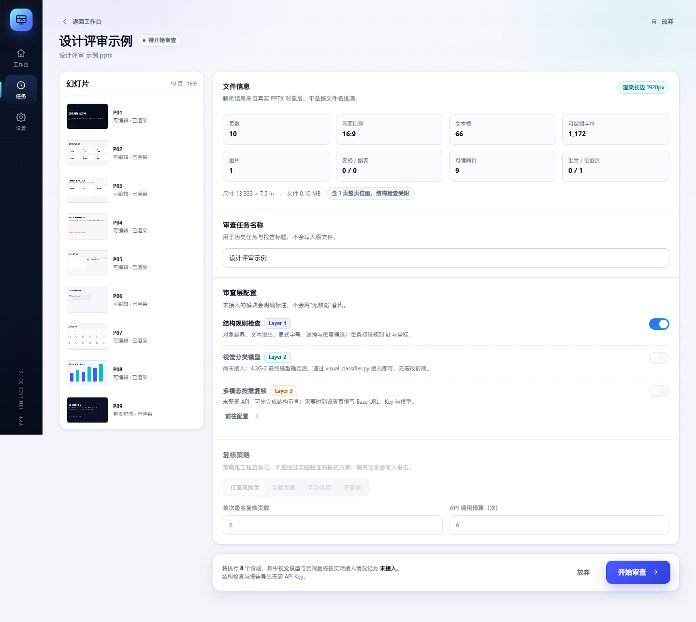
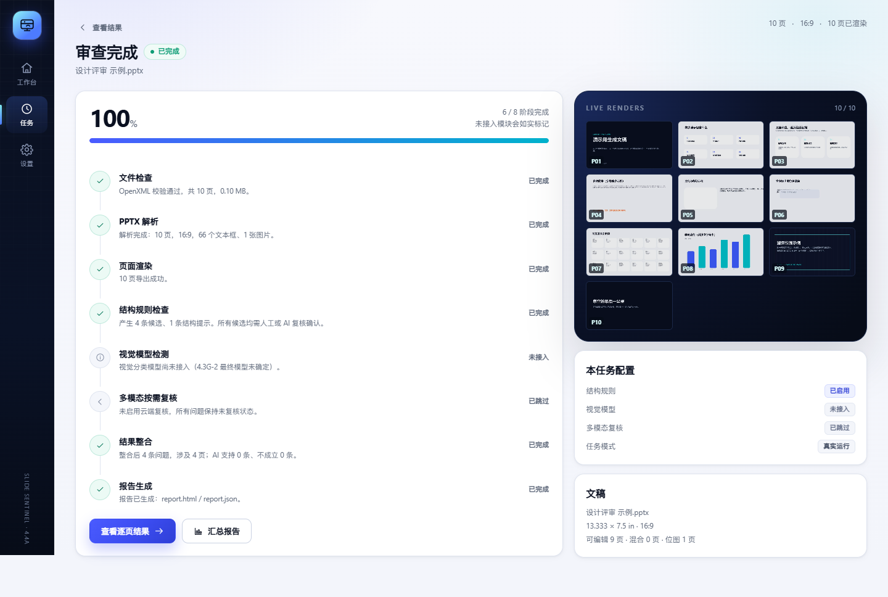
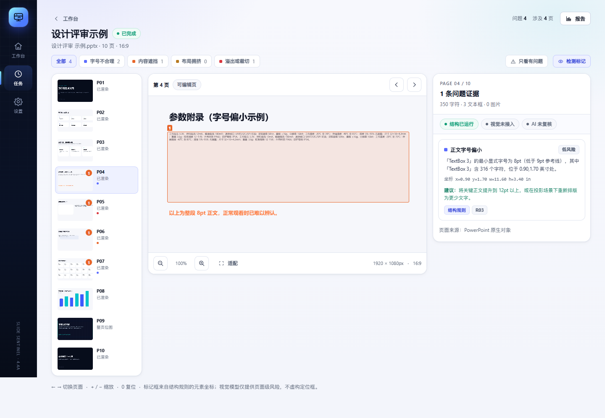
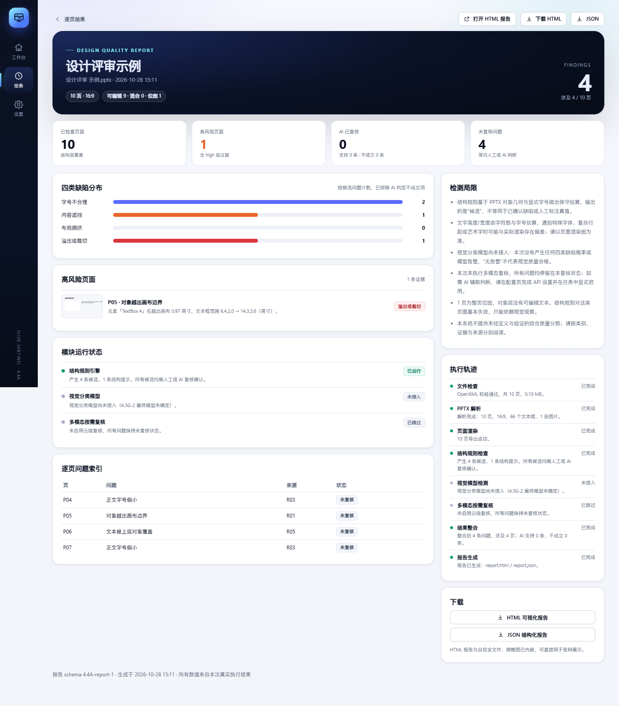
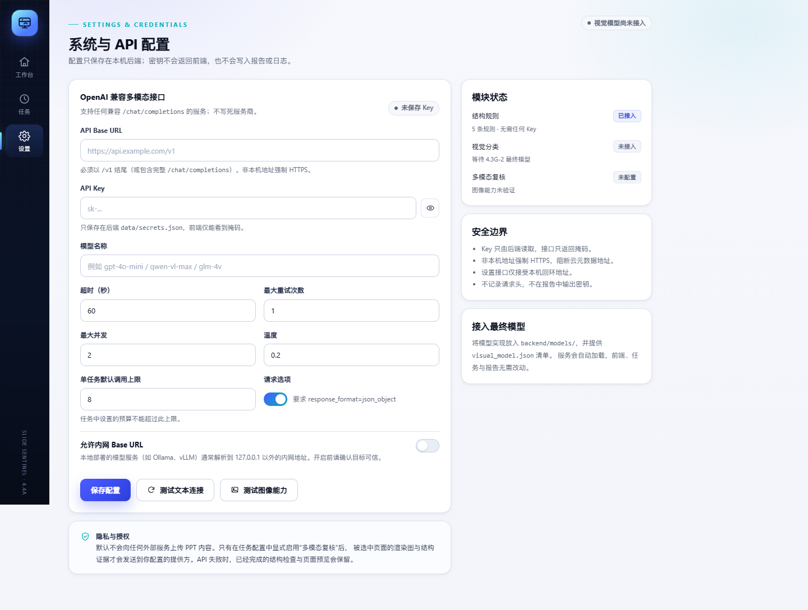
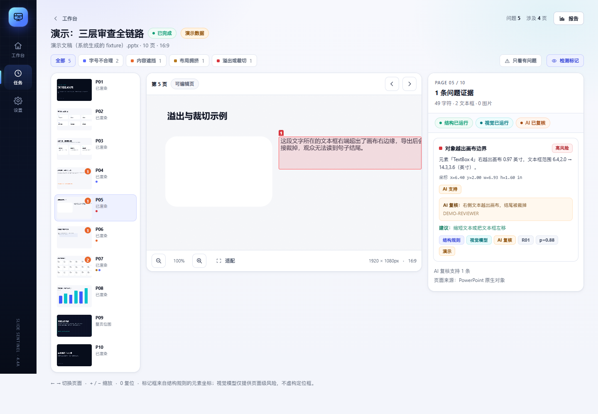

# SlideSentinel · AI PPT 多层质量审查智能体

> 《AI 生成 PPT 的最后一公里——面向 AI 生成演示文稿的多层质量审查与按需复核智能体》
> 4.4B–4.4C：六类实时检测 + 按需复核 + 问题追问；保留原应用框架与界面。

> **不只可以点网页。** 仓库还提供 CLI / MCP 工具外壳，把审查与修复收敛成一条命令，供脚本和其他智能体调用；见 [工具外壳（CLI / MCP）](tooling/README.md)。

本轮交付与接口见 [集成记录](docs/4.4BC/integration_record.md)、[接口说明](docs/4.4BC/interfaces.md)、[实际验收](docs/4.4BC/validation_results.md)。

后续已接入默认关闭的冻结 CLIP 四类辅助模型，手动开启后执行 **R2 六类首筛 → CLIP 四类辅助复核 → LLM 按需复检**；见 [可选 CLIP 接入与验收](docs/4.4BC/clip_optional_integration.md)。

API 配置完整时，任务默认开启 LLM 复检，也可在配置页关闭。进度页的「多模态按需复核」阶段旁提供 **跳过复核**，首轮尚未结束时即可提前跳过，首轮继续完成后展示结果；首轮结束后仍保留 **5 秒跳过窗口**。未跳过则自动复检，整理完成后才展示结果。跳过结果及报告会提示误诊/漏检风险。范围仍受任务策略和预算限制，未检查部分如实保留。见 [默认复检与实际验收](docs/4.4BC/llm_default_review.md)、[DeepSeek 真实请求失败修复](docs/4.4BC/llm_review_failure_fix.md)。

失败、跳过或中断后可点击 **继续审查**，复用经校验的原计划成功步骤和复核结果；也可 **重新审查**。两者均创建新记录并保留父任务。服务重启会识别已中断任务，不自动重发请求。详见 [证据引用与恢复验收](docs/4.4BC/review_recovery.md)。


---

## 1. 这是什么

SlideSentinel 是一个**本地运行**的 PPTX 设计质量审查工作台。它不是聊天框，也不是通用模型管理平台，而是把三层能力放进同一条可追踪的任务流水线：

| 层 | 能力 | 当前状态 |
|---|---|---|
| Layer 1 | 结构规则：对象越界、文本溢出、显式字号、遮挡候选、密度候选 | **已实现，真实运行** |
| 六类专用层 | D1–D6：真实原稿、同次 COM 排版、原 PNG 与跨页结构 | **已接入原 R2 实现；逐项保留可判范围** |
| Layer 2 | 冻结 C：CLIP512 + PNG10 四类页面级辅助概率 | **已接入，默认关闭，可手动开启；不能否决 R2** |
| Layer 3 | 版本化专用规则、full/selective 调度、预算、用户追问 | **已实现；真实 API 需配置，Mock 明确标记** |
| Layer 4 | 证据整合、逐页查看、JSON / HTML / PDF 报告 | **已实现** |

六类缺陷沿用既有研究口径：

1. 字号不合理（`improper_font_sizing`）
2. 内容遮挡（`occluded_content`）
3. 布局拥挤（`cluttered_layout`）
4. 内容溢出或裁切（`content_overflow_cutoff`）
5. 过分留白（`excessive_whitespace`）
6. 异常设计风险（`generative_design_anomaly`，A01–A05；A05 语义检测仍不支持）

**重要原则**：未接入的模块会明确显示“未接入 / 已跳过”，不会用“未发现问题”代替；AI 复核结果只是辅助判断，不写入任何人工标注真值。

---

## 2. 快速开始（Windows）

### 环境要求

- Windows 10/11；
- Python 3.11+（已在 3.13 验证），首次运行需要联网安装后端依赖；
- **日常使用不需要 Node.js**：仓库包含已构建的 `frontend/dist`；只有修改前端源码后才需要 Node.js 20+ 重新构建；
- Microsoft PowerPoint 用于按原始比例渲染页面；没有 PowerPoint 时结构检查仍可运行，但预览、视觉复核和修复前后图不可用；
- 六类专用检测复用同项目的 `ml_stage4/.venv` 与版本化研究实现；未安装或测量失败时明确标记 unsupported/unknown，不伪造正常结果。PDF 导出使用本机 Edge/Chrome。

### 双击启动（推荐）

| 入口 | 用途 |
|---|---|
| `SlideSentinel.cmd` | 立即可用的双击启动入口，无需额外构建 |
| `SlideSentinel.Stop.cmd` | 停止本应用的后端服务 |
| `SlideSentinel.exe` | 可选的轻量图形启动器，构建后使用 |
| `SlideSentinel.Stop.exe` | 可选的轻量图形停止入口，构建后使用 |

首次启动会自动创建 `backend\.venv`、安装 Python 依赖，然后打开 `http://127.0.0.1:8000/`；前端已经构建，不执行 npm install。后续启动会复用现有环境，静默拉起服务并打开浏览器。已经在运行时只打开工作台，不重复启动。

> **EXE 只是启动器，不是独立安装包。**它不包含 Python、依赖、前端或模型，必须保留在完整的 `agent_app` 根目录使用，不能单独复制到桌面。它同样不能消除 PowerPoint、可选 ML 环境和 Edge/Chrome 等外部依赖。

### 构建 EXE 启动器（可选）

仓库提供启动器源码 `tools/launcher/SlideSentinelLauncher.cs`。在 Windows 上执行一次：

```powershell
.\scripts\build_launcher.ps1
```

脚本调用系统自带的 .NET Framework C# 编译器，在根目录生成两个小型 exe；**不使用 PyInstaller，不打包应用文件**。CMD 与 EXE 调用同一组脚本，功能一致。

### 命令行启动与停止

```powershell
.\scripts\start_app.ps1       # 初始化（如需要）并启动
.\scripts\stop_app.ps1        # 停止
```

### 分开启动（开发模式）

```powershell
# 窗口 1：后端（8000）
.\scripts\start_backend.ps1

# 窗口 2：前端热更新（5173）
.\scripts\start_frontend.ps1
```

开发模式访问 `http://127.0.0.1:5173/`，Vite 会把 `/api` 代理到 8000。

### 常用参数

```powershell
.\scripts\start_app.ps1 -Rebuild      # 强制重新构建前端（需要 Node.js）
.\scripts\start_app.ps1 -Port 8010    # 换端口
.\scripts\start_app.ps1 -NoBrowser    # 不自动打开浏览器
.\scripts\start_app.ps1 -Foreground   # 前台运行，Ctrl+C 停止（便于看日志）
```

---

## 3. 工具调用（CLI / MCP）

网页工作台之外，仓库提供一层**工具外壳**。它不复制审查逻辑，而是调用同一个本机服务，把“上传 → 等待 → 报告 → 修复”收敛成一条命令，供脚本和其他智能体使用。

### 命令行

```powershell
# 查看当前机器能做什么（六类 / CLIP / LLM 是否可用）
.\ppt-audit.cmd capabilities

# 审查一份 PPTX；默认 standard：结构 + 六类，不调用 LLM
.\ppt-audit.cmd audit "C:\path\deck.pptx" --profile standard

# 只提交不等待；随后用 status 查询
.\ppt-audit.cmd audit .\deck.pptx --no-wait
.\ppt-audit.cmd status <task_id>

# 下载报告 / 追问单条问题 / 修复
.\ppt-audit.cmd report <task_id> --type html
.\ppt-audit.cmd explain <task_id> <issue_id>
.\ppt-audit.cmd repair <task_id> --review --download-fixed
```

**stdout 只输出 UTF-8 JSON**，进度只写 stderr，适合被其他程序直接解析；加 `--format text` 可看短摘要。三个档位：

| profile | 内容 | 适用 |
|---|---|---|
| `quick` | 结构规则；跳过六类与 LLM（页面仍渲染） | 无 ML 环境、快速初筛 |
| `standard` | 结构规则 + 六类专用检测 | 常规完整跑通，不需要 API Key |
| `deep` | 再加 CLIP 与 LLM 按需复核 | 已配置多模态 API |

### MCP

`ppt-audit-mcp.cmd` 启动一个标准 JSON-RPC over stdio 服务，暴露 `ppt_capabilities`、`ppt_audit`、`ppt_status`、`ppt_report`、`ppt_repair`、`ppt_explain`、`ppt_list`、`ppt_demo` 八个工具。MCP 客户端配置示例见 [`tooling/examples/mcp-config.example.json`](tooling/examples/mcp-config.example.json)，完整说明见 [工具外壳 README](tooling/README.md)。

### 边界

- 工具外壳**不额外打包** Python、模型或 PowerPoint，仍调用本机现有服务；
- 真实文件审查需要 Windows + 桌面版 PowerPoint；六类检测还依赖 `ml_stage4`；
- 未配置 API 时 `deep` 会降级，报告不会伪造复核结论；
- 工具只连接本机服务；现有服务默认监听 `127.0.0.1` 且无鉴权，**不要直接暴露到公网**。

---

## 4. 一次完整审查

1. **拖入 PPTX**（或点击选择文件）。前端先上传，后端完成 OpenXML 校验、解析与按比例渲染，进入配置页。
2. **确认文件信息与预览**。可看到页数、比例、文本框/图片/表格/图表数量、可编辑/混合/位图页数量，以及全部缩略图。
3. **选择审查层与策略**。设置用途、风格、审查重点及可选原始生成 Prompt；六类专用检测默认开启，CLIP 可手动开启。API 配置完整时 LLM 默认开启，也可手动关闭；无 API 时可显式选择 Mock 验证流程，所有模拟结论均为不确定。
4. **开始审查**。进度页展示文件检查、解析、渲染及首轮筛查。可执行 LLM 复检时等待 5 秒，可点击跳过；否则自动复检，结束后统一整理并输出结果。未配置、已关闭、预算为零或无可复检范围时直接整理结果，不空等 5 秒。
5. **逐页查看结果**。左侧页面导航、中间可缩放查看器、右侧问题证据；结构规则的问题会画出真实元素坐标，视觉模型只给页面级风险，不虚构定位框。
6. **追问和导出**。对具体问题补充设计意图，原 Claim 和历史均保留；导出 JSON、自包含 HTML 或由同一模板打印的 PDF。
7. **可选：一键修复**。结构规则给出的条目可在副本上自动修（移回画布 / 换行撑高 / 提字号 / 图层置顶），视觉检测器条目与拥挤、留白、异常设计一律留人工；修复后用同一套结构规则复检，报告 `before → after` 与新增数。原件与审查报告不改。






> 一键修复见 [docs/4.4BC/auto_repair.md](docs/4.4BC/auto_repair.md)：链路、动作词表、复检口径、三次真实执行记录。

---

## 5. 结构规则做了什么

| 规则 | 说明 | 输出 |
|---|---|---|
| R01 对象越界 | 文本/表格/图表元素超出画布 > 0.04 in | 越界方向、越界英寸数、坐标 |
| R02 文本溢出 | 按字号与字符估算文本所需宽高，超出画布或文本框 1.55 倍 | 估算行数/高度、坐标 |
| R03 字号偏小 | 显式字号 < 9pt 且不少于 15 个字符（排除页脚、页码） | 最小字号、涉及对象数 |
| R04 密度偏高 | 文本对象 ≥ 16 且字符 ≥ 550，或图片 ≥ 8 且有文本 | 对象数、字符数、面积占比 |
| R05 遮挡候选 | 文本元素 ≥ 45% 面积被上层不透明对象覆盖 | 覆盖对象、覆盖比例、重叠区域 |
| R06 位图页提示 | 整页位图、文本不在对象层 | 能力受限提示，不是缺陷 |
| R07 字体替换 | 文稿引用本机未安装字体 | 字体列表与渲染差异风险 |

所有 R01–R05 结果都标记为**候选（candidate）**，证据包含规则 id、元素名与英寸坐标；报告不会把它们说成“已确认缺陷”。

估算类规则（R02/R03）使用字符数与字号做保守计算，遇到特殊字体、复杂行距会与真实渲染有偏差，因此系统同时提供原图供核对。

---

## 6. 目录结构

```text
agent_app/
├─ backend/
│  ├─ app/
│  │  ├─ main.py                 # FastAPI 入口、异常格式、SPA 托管
│  │  ├─ config.py               # 路径、限制、阶段定义
│  │  ├─ storage.py              # SQLite 任务库 + 设置 + 密钥文件
│  │  ├─ schemas.py              # Pydantic 请求模型
│  │  ├─ routers/
│  │  │  ├─ tasks.py             # 上传、准备、开始、查询、图片、报告、删除
│  │  │  ├─ demo.py              # 演示任务（独立数据库）
│  │  │  ├─ settings.py          # API 配置 / 连接测试（仅本机）
│  │  │  └─ system.py            # 能力与健康检查
│  │  └─ services/
│  │     ├─ pptx_parser.py       # OpenXML 校验 + 对象层解析
│  │     ├─ renderer.py          # 渲染服务（子进程隔离）
│  │     ├─ render_worker.py     # PowerPoint COM 只读导出
│  │     ├─ structure_rules.py   # Layer 1
│  │     ├─ visual_classifier.py # Layer 2 接入点（未配置时明确报错）
│  │     ├─ mllm.py              # Layer 3 OpenAI 兼容客户端 + SSRF 校验
│  │     ├─ merge.py             # Layer 4 证据整合
│  │     ├─ orchestrator.py      # 8 阶段任务编排
│  │     ├─ report.py            # JSON / HTML 报告
│  │     └─ demo.py              # 演示 fixture 与演示数据
│  ├─ templates/report.html.j2
│  ├─ tests/                     # 后端回归测试
│  ├─ scripts/                   # 集成与验收辅助脚本
│  ├─ models/                    # 视觉模型清单与实现
│  ├─ requirements.txt
│  └─ data/                      # 运行数据（gitignore）
├─ frontend/
│  ├─ src/pages/                 # 首页/配置/进度/结果/报告/设置/任务
│  ├─ src/components/            # 设计系统组件
│  ├─ src/lib/                   # API 客户端与类型
│  └─ dist/                      # 构建产物
├─ fixtures/demo_deck.pptx       # 系统生成的演示文稿（非研究数据）
├─ docs/                         # 集成记录、验收文档与界面截图
│  └─ 4.4A_智能体框架开发报告.md
├─ scripts/                      # 启动、停止、开发与启动器构建脚本
├─ tools/launcher/               # 轻量 EXE 启动器源码与图标
├─ tooling/                      # CLI / MCP 工具外壳（不复制审查逻辑）
│  ├─ ppt_audit_tool/            # 客户端、契约、工作流、MCP 服务
│  ├─ examples/                  # MCP 配置示例
│  ├─ tests/                     # 19 项标准库测试
│  └─ README.md                  # 工具调用完整说明
├─ SlideSentinel.cmd             # 双击启动入口
├─ SlideSentinel.Stop.cmd        # 双击停止入口
├─ ppt-audit.cmd                 # 命令行审查 / 修复入口
├─ ppt-audit-mcp.cmd             # MCP stdio 入口
├─ SlideSentinel*.exe            # 可选：构建后生成的轻量启动器
├─ slidesentinel-output/         # 工具报告与 result.json（gitignore）
├─ .local/                       # 本机旧快捷方式与缓存（gitignore）
└─ README.md
```

---

## 7. 配置多模态 API

进入左侧「设置」：

1. 填写 **Base URL**（例如 `https://api.openai.com/v1`、`https://dashscope.aliyuncs.com/compatible-mode/v1`）。
2. 填写 **API Key** 与**模型名称**（需要支持图片输入，如 `gpt-4o-mini`、`qwen-vl-max`、`glm-4v`）。
3. 保存后点击「测试文本连接」，再点「测试图像能力」。
4. 在任务配置页确认默认开启的「多模态按需复核」，选择策略与预算，也可手动关闭。

安全约定：

- Key 只保存在后端 `backend/data/secrets.json`，接口只返回掩码；
- 非本机地址默认要求 HTTPS；明文 HTTP 需在设置页手动打开「允许非本机 HTTP」才放行，云元数据地址与 URL 内嵌凭据始终拒绝；内网地址另需「允许内网 Base URL」；
- API 配置完整时，新任务默认启用复检；首轮结束后的 5 秒窗口内可跳过，也可在任务配置页提前关闭。复检开始后会把选中页面的 JPEG、结构证据及可选 CLIP 辅助证据发送到配置的服务。已发送的请求不能通过跳过撤回；
- 请求失败会逐页记录，不影响已完成的结构检查与报告。



---

## 8. 演示模式

首页底部「演示」区域提供四种场景：

- **完整演示**：结构 + 演示视觉概率 + 演示 AI 复核；
- **高风险**：整体抬升概率，展示筛选与高风险页；
- **API 失败**：模拟云端复核网络失败，验证其他结果保留；
- **模块缺失**：模拟视觉与复核未接入时的降级展示。

演示任务：

- 使用系统生成的 `fixtures/demo_deck.pptx`，不是研究基准；
- 存放在独立数据库 `data/demo.db` 与独立目录，**不会混入真实任务列表**；
- 报告顶部与页脚强制显示 `DEMO`，视觉模型名称为 `DEMO-FIXTURE（演示占位，非真实模型）`；
- 不调用外部 API。



---

## 9. 数据隔离与安全

- 应用数据全部位于 `agent_app/backend/data`，不读写 `ml_stage4/benchmark_*`、模型文件或人工标签。
- 上传只接受 `.pptx`：校验 ZIP/OpenXML、拒绝宏工程、限制解压比、80 MB / 200 页上限。
- 任务 ID 为 16 位十六进制；图片与报告路径由 ID + 固定文件名生成，不接受用户路径。
- 渲染在独立子进程中执行，超时会终止进程树；源文件渲染前后校验 SHA-256。
- 设置接口仅接受本机回环地址。
- API Key 不写入报告、不打印日志；错误信息会脱敏。

---

## 10. 测试

```powershell
cd backend
.\.venv\Scripts\python.exe -m pytest
```

当前测试集共 **301 项**。正常 Windows 环境应全部通过；在启用批量删除保护的环境（例如 WorkBuddy 的 safe-delete）中，`test_clip_runtime` 的 2 项会在清理临时文件时被拦截，属于测试环境限制，不是业务断言失败。覆盖：

- 能力探测、六类检测接入与历史 CLIP 可选层（默认关闭、不否决 R2）；
- 非法文件/伪装 PPTX 拒绝；
- 上传 → 解析 → 渲染 → 六类筛查 → 按需复核 → 报告完整闭环；
- 两阶段准备与开始审查（含任务改名）；
- 设置校验、密钥掩码、SSRF 拦截与明文 HTTP 放行开关；
- 本地 Mock OpenAI 端点的真实 HTTP 多模态复核；
- API 不可达时任务 `completed_with_errors`，结构结果与报告保留；
- 复核恢复（继续审查 / 重新审查）与中断任务识别；
- 一键修复的 11 项：视觉条目锁定、模型不得发明动作、复检口径；
- 演示任务隔离；
- 任务删除。

工具外壳（独立于后端测试）：

```powershell
cd tooling
..\backend\.venv\Scripts\python.exe -m unittest discover -s tests -v
```

当前 **19 项全部通过**，覆盖 profile 一致性、报告投影与可见性、MCP 协议、multipart 与参数解析。

前端：

```powershell
cd frontend
npm run typecheck
npm run build
```

已用 Playwright + Edge 实际跑通：首页 → 上传真实 PPTX → 配置 → 进度 → 结果 → 报告 → 设置 → 任务列表；1440×900 与 1366×768 均无横向溢出，控制台无报错。

---

## 11. 已知限制

1. **历史 CLIP 默认关闭**：六类检测默认运行；CLIP 只是可选辅助，不否决 R2，也没有证据表明它提高准确率。
2. **渲染依赖 PowerPoint COM**：仅 Windows；未安装 PowerPoint 时页面预览与多模态复核不可用，结构检查与报告仍可完成。
3. **结构规则是候选**：几何重叠不等于真实遮挡，文本高度为估算；需结合渲染图与 AI/人工复核。
4. **没有综合评分**：未定义经验证的评分公式，报告只呈现可解释的计数与证据。
5. **无账号体系**：按本地单用户设计，设置接口限制本机访问。
6. **自动修复只覆盖结构类**：拥挤、留白、异常设计、以及所有视觉检测器条目只能人工；组合内对象与继承字号也改不了。
7. **大文件/超多页**：受 80 MB / 200 页限制；渲染耗时随页数增长。

---

## 12. 后续接入最终视觉模型

无需改前端、任务系统或报告，只需两步：

1. 把实现放到 `backend/models/`，例如 `visual_model_impl.py`：

```python
def predict_slide(png_path, config):
    # 按 4.3G-2 确定的 recipe 读取图片、预处理、推理
    return {
        "probabilities": {
            "improper_font_sizing": 0.12,
            "occluded_content": 0.03,
            "cluttered_layout": 0.41,
            "content_overflow_cutoff": 0.07,
        },
        "alerts": {
            "improper_font_sizing": 0,
            "occluded_content": 0,
            "cluttered_layout": 0,
            "content_overflow_cutoff": 0,
        },
    }
```

2. 写 `backend/models/visual_model.json`：

```json
{
  "adapter": "python_module",
  "module": "visual_model_impl",
  "callable": "predict_slide",
  "model_version": "g2-final-2026xxxx",
  "work_point": "4.3G-2 阈值与工作点说明",
  "labels": ["improper_font_sizing", "occluded_content", "cluttered_layout", "content_overflow_cutoff"],
  "thresholds": {
    "improper_font_sizing": 0.5,
    "occluded_content": 0.5,
    "cluttered_layout": 0.5,
    "content_overflow_cutoff": 0.5
  },
  "input_recipe": "full-slide PNG, long edge 1920, RGB"
}
```

重启后端后，「设置」与首页会显示已接入；任务中的视觉阶段自动变为“已运行”，结果页出现页面级概率与告警。详见 [`docs/4.4A_智能体框架开发报告.md`](docs/4.4A_智能体框架开发报告.md)。

---

## 13. 常见问题

**Q：页面预览是空白/渲染失败？**
确认本机安装了桌面版 PowerPoint，并且没有以其他用户身份占用；到 `backend\data\tasks\<id>\renders\render_report.json` 查看错误。也可用 `scripts\start_backend.ps1` 前台模式观察日志。

**Q：上传后一直停在“解析与渲染中”？**
大文件或复杂动画会慢一些；超过 420 秒会超时并终止。可查看任务页的阶段信息。

**Q：配置了 API 但任务里不能勾选？**
设置页需要先保存 Base URL / Key / 模型，并且「测试图像能力」通过。保存后刷新任务配置页。

**Q：报告里的“未复核”是什么意思？**
表示该问题只经过结构规则或视觉模型，尚未被人工或 AI 复核；不是“已确认”。

**Q：会修改我的 PPT 吗？**
不会。上传文件另存为 `source.pptx`，渲染前后校验 SHA-256，全程只读。
